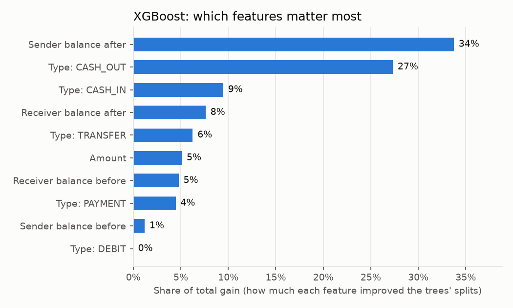
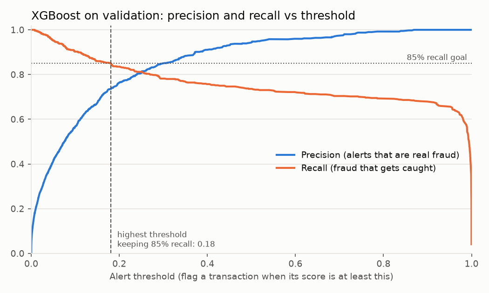

# XGBoost feature importance and threshold report (VW-31)

Generated by `python src/vaultwatch/models/xgb_report.py --data full`.
Trained on the training split (steps 1-323, 4,463,587 rows, 3,643 fraud) with the VW-30 settings, scored on the validation split (steps 324-378, 980,416 rows, 564 fraud). The test split was not used.

**Validation PR-AUC: 0.904**

## Which features matter most

Share of total gain (how much each feature improved the trees' splits):

| Feature | Share of gain |
|---|---:|
| Sender balance after (`newbalanceOrig`) | 33.8% |
| Type: CASH_OUT (`type_CASH_OUT`) | 27.3% |
| Type: CASH_IN (`type_CASH_IN`) | 9.5% |
| Receiver balance after (`newbalanceDest`) | 7.6% |
| Type: TRANSFER (`type_TRANSFER`) | 6.3% |
| Amount (`amount`) | 5.1% |
| Receiver balance before (`oldbalanceDest`) | 4.8% |
| Type: PAYMENT (`type_PAYMENT`) | 4.5% |
| Sender balance before (`oldbalanceOrg`) | 1.2% |
| Type: DEBIT (`type_DEBIT`) | 0.0% |

## Precision and recall vs threshold

| Threshold | Alerts | Fraud caught | Precision | Recall |
|---:|---:|---:|---:|---:|
| 0.1 | 896 | 509 / 564 | 0.568 | 0.902 |
| 0.18 | 652 | 480 / 564 | 0.736 | 0.851 |
| 0.3 | 518 | 441 / 564 | 0.851 | 0.782 |
| 0.5 | 439 | 415 / 564 | 0.945 | 0.736 |
| 0.7 | 407 | 397 / 564 | 0.975 | 0.704 |
| 0.9 | 382 | 382 / 564 | 1.000 | 0.677 |

The highest threshold that still catches 85% of validation fraud is **0.180**. The final alert threshold belongs to the ensemble (VW-48), so this is input for that choice, not a decision.
